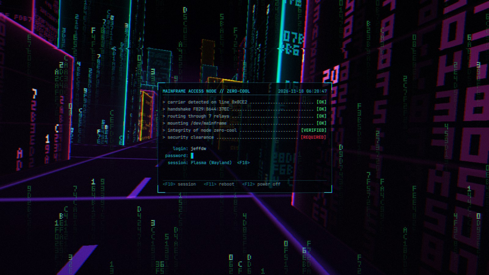
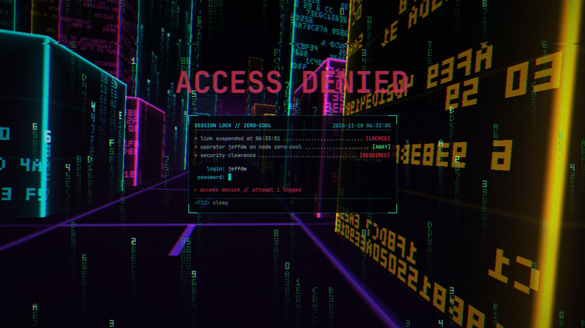
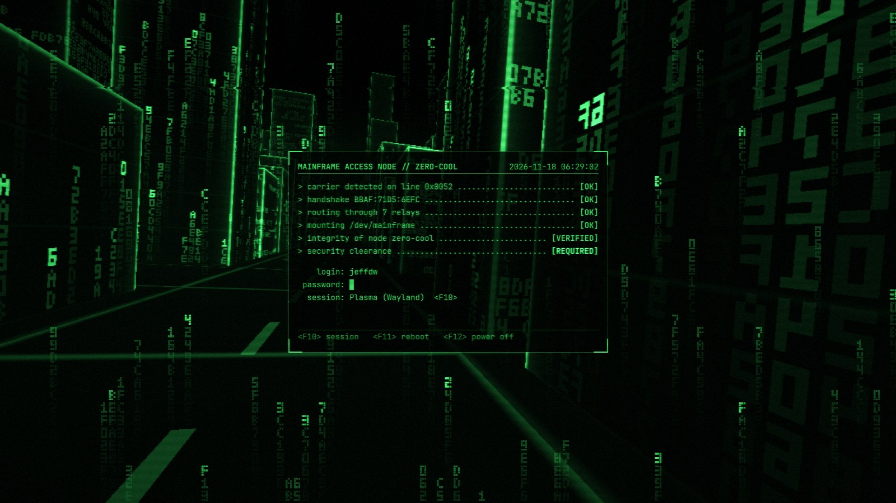
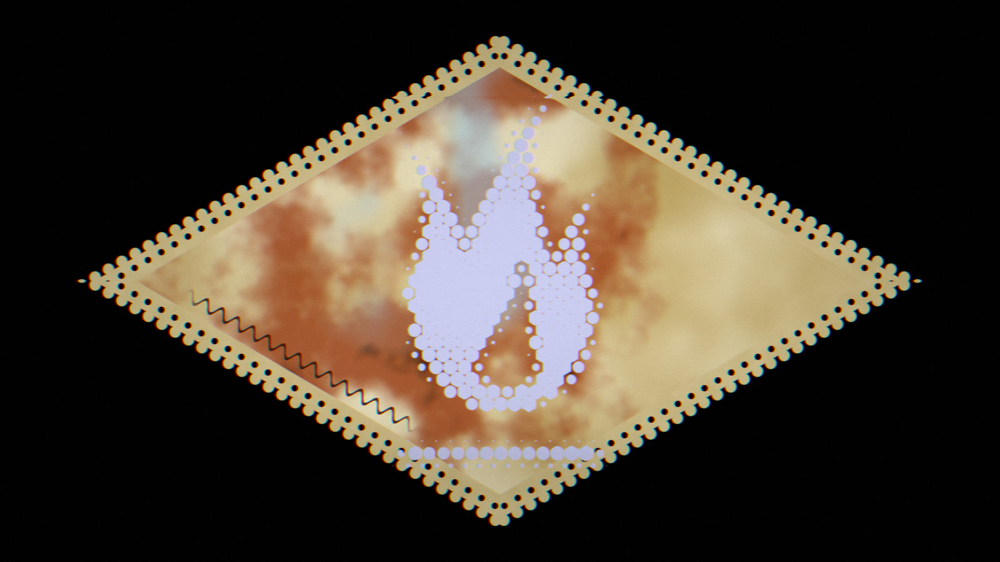
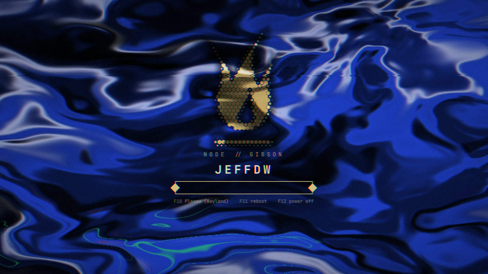
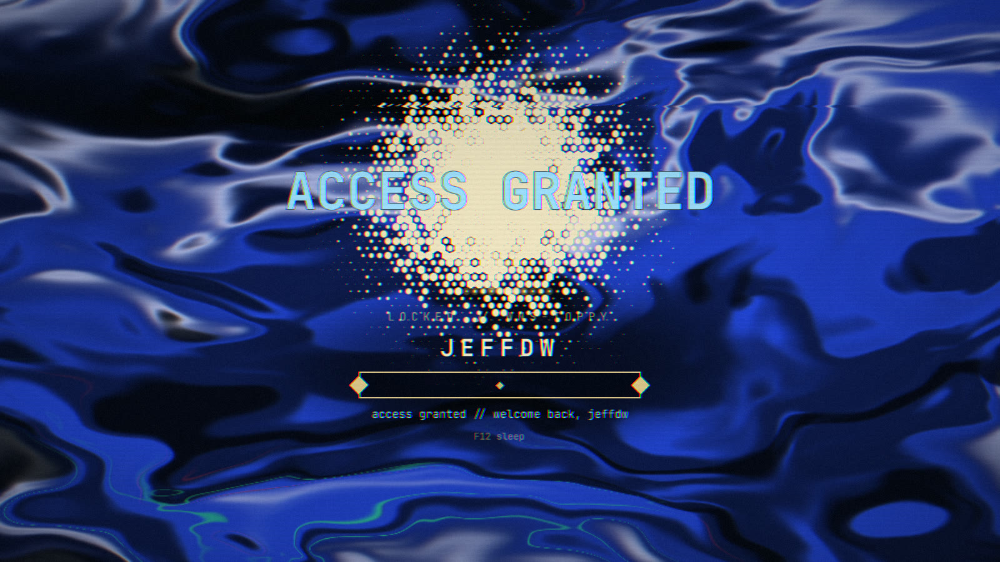
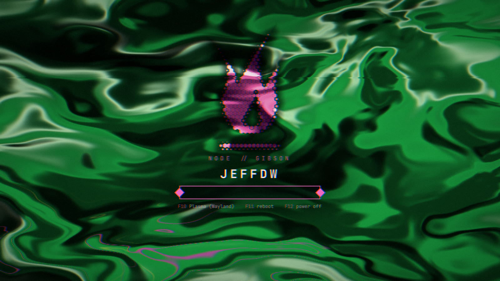

# datastream

Two sets of login themes for SDDM (Qt 6), each with a matching Plasma 6
lock screen:

- **datastream** (below): a flight through a neon city with a retro
  terminal.
- **acidburn** (see [acidburn](#acidburn)): a burning halftone flame over
  liquid plasma, after Acid Burn's login screen in *Hackers*.

The install scripts take the set's name and default to datastream.

## datastream

A login theme for SDDM (Qt 6) and a matching Plasma 6 lock screen. The
camera flies down an avenue of neon towers covered in streaming hex, green
hex rain falls over the top, and a retro terminal types out a boot log
before asking for your password. A wrong password tears the screen apart
with a glitch burst and a flickering ACCESS DENIED; the right one flashes
ACCESS GRANTED and the camera warps forward. Every so often the camera
rises above the rooftops for a skyline pass.

The lock screen uses the same scene and terminal with a shorter boot log
and the user fixed to the one who is locked out.

## Install

### Login screen (SDDM)

    ./install-sddm.sh              # datastream
    ./install-sddm.sh acidburn     # acidburn
    sddm-greeter-qt6 --test-mode --theme /usr/share/sddm/themes/datastream

Then select it in System Settings > Login Screen (SDDM).

### Lock screen

    ./install-lock.sh                     # install or update datastream
    ./install-lock.sh acidburn            # install or update acidburn
    ./install-lock.sh acidburn --test     # install, then open a test lock screen
    ./install-lock.sh acidburn --uninstall

No sudo needed. Plasma's locker (`kscreenlocker_greet`) loads
`lockscreen/LockScreen.qml` from the Plasma shell package named by
`$PLASMA_DEFAULT_SHELL`. The script installs a shell package,
`~/.local/share/plasma/shells/datastream.lockscreen`, that holds only the
lock screen, and sets `PLASMA_DEFAULT_SHELL` for KWin alone through a
systemd drop-in
(`~/.config/systemd/user/plasma-kwin_wayland.service.d/datastream-lockscreen.conf`).
KWin starts the locker, so the locker sees it; plasmashell is a separate
service and keeps the normal desktop shell. The drop-in takes effect at the
next login. If the QML ever fails to load, kscreenlocker falls back to its
built-in lock screen, so a broken theme cannot leave you unable to unlock.

Both sets share that one drop-in, so the set installed last is the lock
screen in use. `--uninstall` removes the set's package, and removes the
drop-in only when it points at that set.

The lock screen package needs `"X-Plasma-APIVersion": "2"` in its metadata,
or kscreenlocker logs "Lockscreen QML outdated" and uses Breeze.

### Settings window

    ./install-settings.sh              # install or update
    ./install-settings.sh --uninstall

Adds "datastream settings" to the application launcher: a live preview with
the palette, the node name in the terminal header, and switches for the
flying city and the hex rain. Apply saves the choices to
`~/.config/datastream/settings.conf` and pushes them to both screens:
the login screen's `theme.conf.user` (through pkexec, so it asks for your
password) and the lock screen's `settings.js`. `install-lock.sh` merges
`settings.conf` too, so reinstalling keeps them. Plasma's own Login Screen
settings page can only change a theme's background, which is why this is a
separate window.

## Keys

| Key | Login screen | Lock screen |
| --- | --- | --- |
| Enter | next line / log in | unlock |
| Tab, Shift+Tab | switch between login and password | |
| Up / Down (login line) | cycle users | |
| F10 | cycle sessions | |
| F11 | reboot | |
| F12 | power off | sleep |
| Escape | clear password | clear password (and the locker blanks the screen) |
| any key during boot log | skip to the prompt | skip to the prompt; typed characters go into the password |

## Palettes

`Palette=` in `theme.conf` picks the colors:

- `neon` (default): cyan, magenta and amber towers under green hex rain.
- `phosphor`: an old green monochrome monitor. The CRT pass maps the whole
  image onto one green by brightness, so everything is a shade of green;
  ACCESS DENIED shows in the hottest near-white green instead of red.

Palettes are defined in `shared/palettes.js`; add one there and select it
by name. Any color key set in `theme.conf` (they are listed there,
commented out) overrides the palette's value for that key.

## Tuning

The settings window covers the common options. Everything else lives in
`theme.conf`: palette, node name, city and rain switches, colors, flight speed, the rooftop climb,
rain density and opacity, scanline strength and idle glitches.
`RenderScale` sets the resolution the city is raycast at (0.75 of the
screen by default); drop it to 0.5 on a weak GPU or a 4K panel.

SDDM reads `theme.conf` directly, with `theme.conf.user` on top. The lock
screen has no config object, so `install-lock.sh` converts `theme.conf` plus
`~/.config/datastream/settings.conf` to `settings.js` with
`tools/conf2js.sh` (adding the host name); rerun the installer after
editing `theme.conf`.
The lock screen also takes `UnlockDelay`, the milliseconds ACCESS GRANTED
plays before the desktop comes back (default 1200).

## acidburn

A wide diamond with a beaded, perforated cream border sweeps in from its
right corner, burns from the center to white heat and cools into scorched
paper while a flame pops in as hex halftone dots. Then the diamond breaks
into shrinking dots, liquid blue plasma floods in behind, and the flame
drifts up to rest above the prompt, recolored in gold from the plasma
behind it. The intro plays once (about seven seconds; any key skips it)
and the plasma keeps flowing after.

What it reacts to:

- Moving the mouse stirs a whirlpool into the plasma around the pointer.
- Typing makes the flame flare taller and brighter and speeds up the flow.
  Each password character drops into the field as a dot.
- A wrong password knocks the flame's dots off their grid, red hot, with a
  glitch and ACCESS DENIED.
- The right one floods the screen with cream halftone dots from the flame
  outwards, then fades to black.

Keys are the same as datastream's, with the handle line standing in for
the login line. The lock screen waits `UnlockDelay` ms (default 1400) for
the flood before it exits.

Options live in `acidburn/theme.conf`: `Palette` (`film` or `toxic`),
`NodeName`, `Intro`, `PointerSwirl`, `FlowSpeed`, `RenderScale` (the plasma
is rendered at this fraction of the screen, 0.6 by default),
`HalftoneDots`, `Scanlines`, `IdleGlitch`, and every palette color. The
settings window only manages datastream for now.

## Layout

- `shared/Scene.qml`: city, rain, CRT pass, glitch/flash drivers, banner, warp.
- `shared/Terminal.qml`: boot log, prompts, status line and key handling.
  Talks to its owner through signals, so it has no SDDM or PAM code.
- `shared/Banner.qml`: the big ACCESS GRANTED / DENIED word.
- `shared/palettes.js`: the color palettes `Palette=` chooses from.
- `settings/`: the settings window (PySide6 backend, Kirigami QML front end
  that reuses `shared/Scene.qml` for the preview).
- `shared/shaders/city.frag`: the city, a 2D grid raycast with one box per cell.
- `shared/shaders/rain.frag`: screen-space hex rain.
- `shared/shaders/post.frag`: chromatic split, glitch bands, scanlines, vignette,
  and the monochrome phosphor mapping.
- `sddm/Main.qml`: wires the terminal to SDDM's `sddm`, `userModel` and
  `sessionModel`.
- `lockscreen/LockScreen.qml`: wires the terminal to kscreenlocker's
  `authenticator`.
- `sddm/shared` and `lockscreen/shared` are symlinks to `shared/` so each
  entry point can `import "shared"` from the repo the same way it does
  once installed.
- `acidburn/` has the same layout for the second set: `theme.conf`,
  `sddm/`, `lockscreen/` and `shared/`. `shared/Scene.qml` runs the intro
  and reactions, `shared/Prompt.qml` is the prompt (same API as
  `Terminal.qml`, so the SDDM and lock screen wiring matches),
  `shared/shaders/plasma.frag` is the plasma and `shared/shaders/emblem.frag`
  draws the diamond, flame and outro over it. `Banner.qml` and
  `post.frag.qsb` in `acidburn/shared` are symlinks to the top-level
  `shared/`; the install scripts copy them in as plain files.

The glyphs are a hand-made 3x5 hex font packed into floats
(`tools/font.py`), shared by the city and rain shaders. After editing a
`.frag` in either set, run `./build-shaders.sh`.

## Testing without installing

`harness/` has mock context objects so both screens can be screenshotted
with the plain `qml` runtime (password "hack" succeeds):

    tools/conf2js.sh theme.conf > lockscreen/settings.js
    QT_FORCE_STDERR_LOGGING=1 qml6 harness/lock.qml -- "$PWD/lockscreen" /tmp/shots
    QT_FORCE_STDERR_LOGGING=1 qml6 harness/sddm.qml -- "$PWD/sddm" /tmp/shots

acidburn has its own scripts, which shoot the intro phase by phase:

    tools/conf2js.sh acidburn/theme.conf > acidburn/lockscreen/settings.js
    QT_FORCE_STDERR_LOGGING=1 qml6 harness/acidburn-lock.qml -- "$PWD/acidburn/lockscreen" /tmp/shots
    QT_FORCE_STDERR_LOGGING=1 qml6 harness/acidburn-sddm.qml -- "$PWD/acidburn/sddm" /tmp/shots [toxic]

Under a systemd session Qt logs to the journal, so without
`QT_FORCE_STDERR_LOGGING=1` QML errors are silent.
