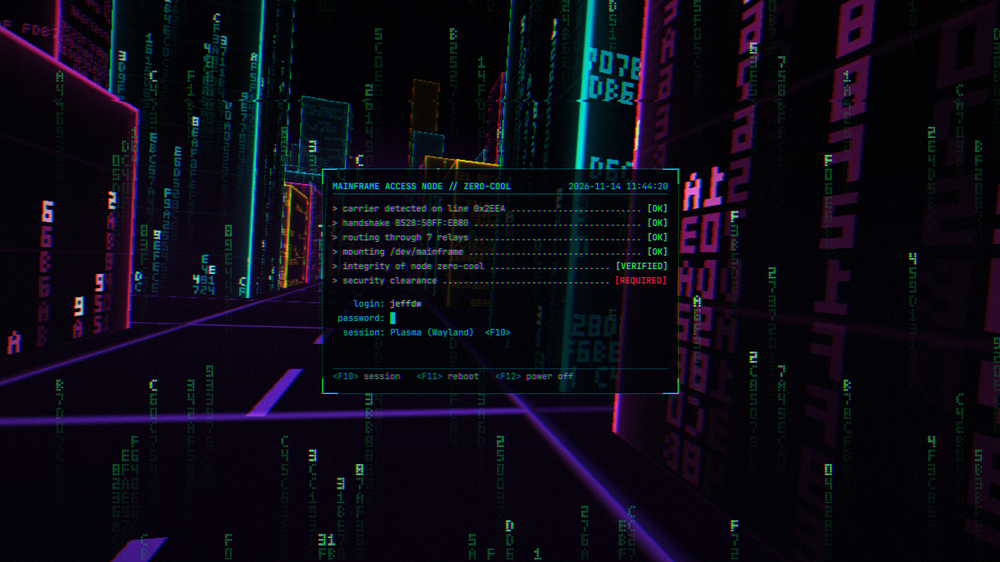

# datastream

An SDDM (Qt 6) login theme: the camera flies down an avenue of neon towers
covered in streaming hex, green hex rain falls over the top, and a retro
terminal types out a boot log before asking for your password. A wrong
password tears the screen apart with a glitch burst and a flickering
ACCESS DENIED; the right one flashes ACCESS GRANTED and the camera warps
forward. Every so often the camera rises above the rooftops for a skyline
pass.

## Install

    ./install.sh
    sddm-greeter-qt6 --test-mode --theme /usr/share/sddm/themes/datastream

Then select it in System Settings > Login Screen (SDDM).

## Keys

| Key | Action |
| --- | --- |
| Enter | next line / log in |
| Tab, Shift+Tab | switch between login and password |
| Up / Down (login line) | cycle users |
| F10 | cycle sessions |
| F11 / F12 | reboot / power off |
| Escape | clear password |
| any key during boot log | skip to the prompt |

## Tuning

Everything lives in `theme.conf`: colors, flight speed, the rooftop climb,
rain density and opacity, scanline strength and idle glitches.
`RenderScale` sets the resolution the city is raycast at (0.75 of the
screen by default); drop it to 0.5 on a weak GPU or a 4K panel.

## Layout

- `Main.qml`: scene, flight clock, glitch/flash drivers, CRT pass.
- `Terminal.qml`: boot log, prompts, SDDM login calls, key handling.
- `Banner.qml`: the big ACCESS GRANTED / DENIED word.
- `shaders/city.frag`: the city, a 2D grid raycast with one box per cell.
- `shaders/rain.frag`: screen-space hex rain.
- `shaders/post.frag`: chromatic split, glitch bands, scanlines, vignette.

The glyphs are a hand-made 3x5 hex font packed into floats, shared by the
city and rain shaders. After editing a `.frag`, run `./build-shaders.sh`.
